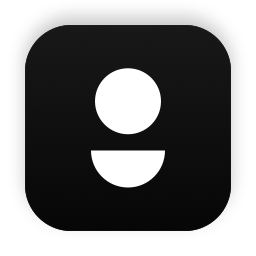
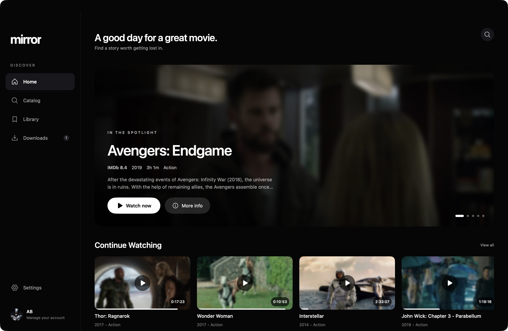
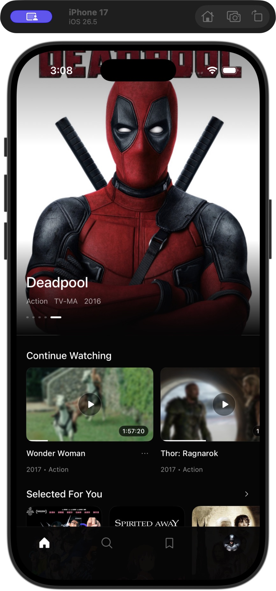
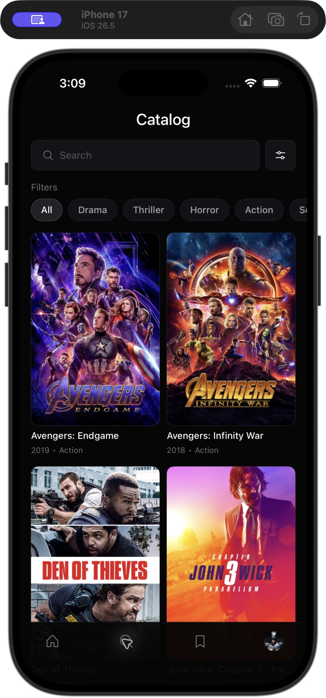
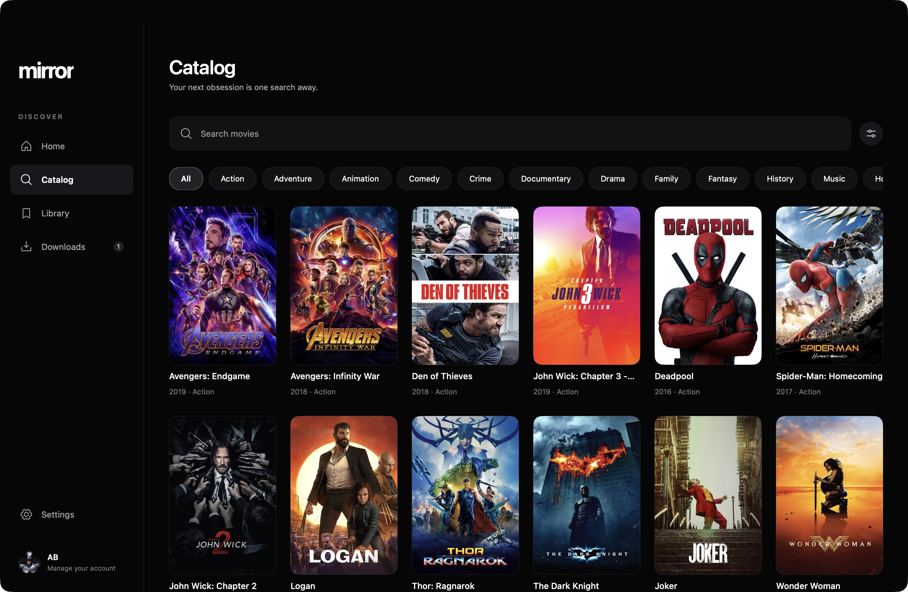

<p align="center">
  
</p>
<h1 align="center">Mirror</h1>
<p align="center"><strong>A world of stories.</strong></p>
<p align="center">Native movie apps for iOS and macOS. One library, wherever you watch.</p>
<p align="center">
  <a href="https://github.com/Imperial-lord/mirror/actions/workflows/ci.yml"></a>
</p>
<p align="center">
  <a href="#features">Features</a> · <a href="#screenshots">Screenshots</a> · <a href="#getting-started">Getting started</a> · <a href="#architecture">Architecture</a>
</p>



Mirror pairs a quiet, cinematic interface with live movie discovery, a personal library, and playback that follows you between devices. Both apps use Firebase for account data and an independently deployed streaming service for video delivery.

## Features

| | |
| --- | --- |
| **Find your next movie** | Search the YTS catalog, filter by genre/year/rating, explore curated collections, and get recommendations from your watch history. |
| **Make it yours** | Profiles, Favorites, custom playlists, and watch history shared through Firestore. Resume unfinished movies directly; titles become watched after more than 95% completion. |
| **Press play** | AVPlayer with HTTP-range streaming, seeking, quality and speed controls, subtitles with English fallback, and fullscreen playback. Torrent handling lives on the server. |
| **Take it offline** | Resumable local downloads, a chosen video quality, multiple saved subtitle languages, and playback using only the files available on that device. |
| **Feel at home** | Dark, light, and system appearance. A dedicated desktop sidebar, resizable layouts, native sharing, volume/mute controls, and keyboard shortcuts on Mac. |

## Screenshots

<table>
  <tr>
    <th>iOS · Home</th>
    <th>iOS · Catalog</th>
  </tr>
  <tr>
    <td align="center"></td>
    <td align="center"></td>
  </tr>
</table>

<details>
<summary><strong>Explore the macOS catalog</strong></summary>
<br>

</details>

Captured from the running native Mac app and the iPhone 17 simulator. See [screenshot notes](docs/screenshots/README.md).

## Getting started

This is a development project: configure and build the apps locally. Public installers, notarized distribution, and automatic updates are not configured yet.

| Component | Requirements | Project / guide |
| --- | --- | --- |
| **iOS** | Xcode with an iOS 17+ SDK, XcodeGen | `apps/ios/Mirror.xcodeproj` · scheme `Mirror` |
| **macOS** | Xcode 26.1+, macOS 14+ deployment target, XcodeGen, Apple development signing | [Mac setup and shortcuts](apps/macos/README.md) · scheme `MirrorDesktop` |
| **Streaming** | Node.js 22+, Firebase Admin configuration for public hosting | [Streaming service guide](services/streaming/README.md) |

### Configure the apps

1. Register the iOS and macOS bundle IDs as separate Apple-platform apps in your Firebase project.
2. Download each app's `GoogleService-Info.plist` into its own `apps/ios/Config/` or `apps/macos/Config/` directory.
3. Copy that directory's `Local.xcconfig.example` to `Local.xcconfig`. Set the matching bundle ID, development team, streaming origin, and `REVERSED_CLIENT_ID` from the Firebase plist.
4. Generate the desired project, open it in Xcode, and run its shared scheme:

```sh
# iOS
xcodegen generate --spec apps/ios/project.yml --project apps/ios

# macOS
xcodegen generate --spec apps/macos/project.yml --project apps/macos
```

Private configuration stays ignored by Git. URL separators in xcconfig use `http:/$()/` or `https:/$()/` to avoid comment parsing. Regenerate and commit the Xcode project after changing `project.yml` or source membership.

Mac authentication uses the Data Protection keychain and requires the checked-in entitlements with a matching development signing identity/profile. See the [Mac signing notes](apps/macos/README.md#build); removing those entitlements is not a substitute for correct signing.

### Run the streaming service

```sh
cd services/streaming
cp .env.example .env
npm ci --omit=optional
npm start
```

Set the app's streaming origin to the server you run. Deployment configuration, Docker, Firebase authentication, and HTTP-range endpoints are documented in the [service guide](services/streaming/README.md). The server is deployed independently; CI does not deploy to OCI.

## Architecture

| Directory | Purpose |
| --- | --- |
| `apps/ios/` | iOS UI, models, portable catalog/data services, configuration, and tests |
| `apps/macos/` | Native desktop UI, AppKit integration, player/window lifecycle, configuration, and tests |
| `services/streaming/` | Independently deployable Node/WebTorrent service delivering video to AVPlayer |
| `infra/firebase/` | Firestore rules, indexes, and local emulator configuration |
| `packages/` | Standalone packages; the legacy SwiftTorrent adapter is not linked into either app |
| `scripts/` | Project bootstrap, test runners, repository checks, and Mac icon generation |
| `docs/` | Feature notes, screenshots, design references, and asset licenses |

The Mac target references portable models, catalog/history/library services, and artwork from the iOS source tree while keeping its desktop UI under `apps/macos/MirrorDesktop/`. Firebase synchronizes account data; downloads remain local to each device.

## Development & checks

Client integration tests require Firebase CLI and Java. Run from the repository root:

```sh
npm --prefix services/streaming ci --omit=optional
npm --prefix services/streaming test
bash scripts/test-ios.sh
bash scripts/test-macos.sh
```

Local iOS tests default to the existing **iPhone 17**; override `IOS_DESTINATION` to use an explicit simulator. Authentication/profile integration tests target only the `demo-mirror-auth` emulators.

CI checks both apps in Debug and Release, runs client/server tests and a Docker build, and scans for secrets and repository-boundary violations. The two Mac authentication integration tests require a locally signed build and are excluded from credential-free hosted CI; the other Mac tests run there. CI bootstraps dummy configuration, which supports builds and emulator tests rather than production sign-in.

- **`develop`** is the integration branch and repository default. Target everyday feature/fix PRs here.
- **`main`** receives reviewed promotions from `develop`. Security, server, iOS, macOS, and promotion checks must pass; branches must be up to date and conversations resolved. Force pushes, branch deletion, and administrator bypasses are disabled.

Use merge commits for promotions, then merge `main` back into `develop` to preserve branch history. See [SECURITY.md](SECURITY.md) for configuration handling. Optional Debug-only auth autofill uses local scheme environment variables; never commit credentials to a shared scheme.

## Credits

Design inspiration: [Online Cinema App — Mirror by Sasha Dobrynina](https://www.behance.net/gallery/211500071/Online-Cinema-App-Mirror). Interface icons: [Phosphor](docs/icon-system.md), used under its [MIT license](docs/licenses/Phosphor-MIT.txt). Catalog and person metadata use YTS and Wikimedia/Wikidata. Movie artwork shown in screenshots belongs to its respective owners.

Project license: [MIT](LICENSE).
